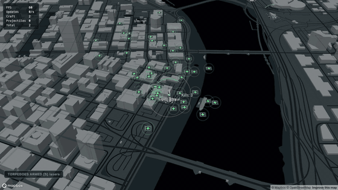
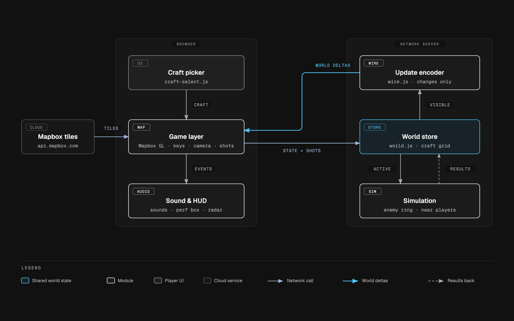
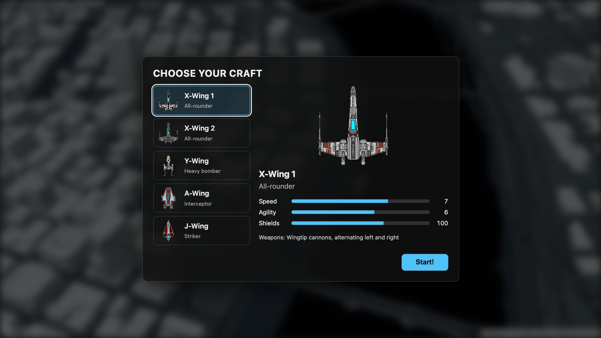
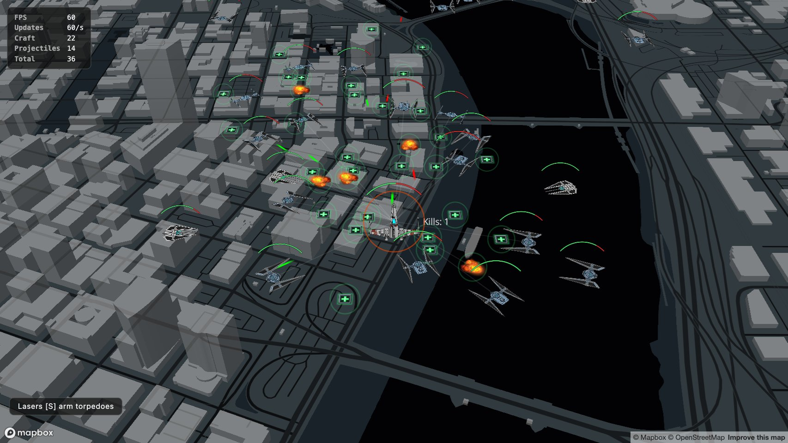
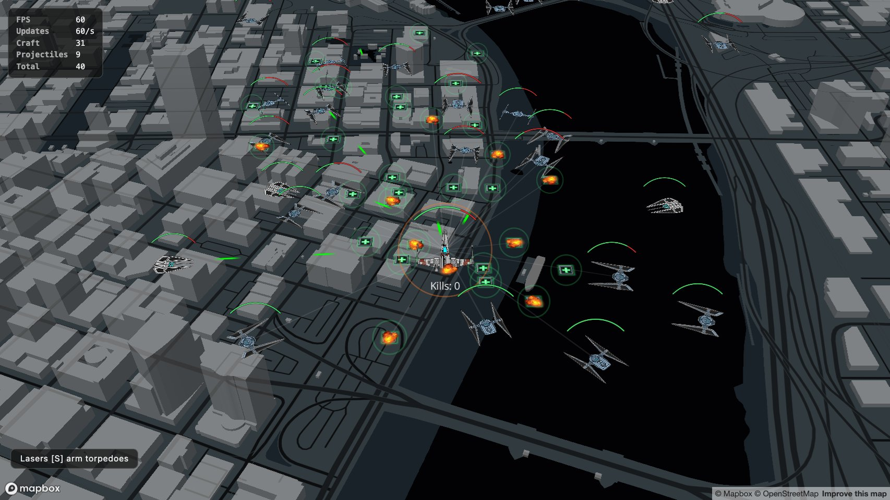
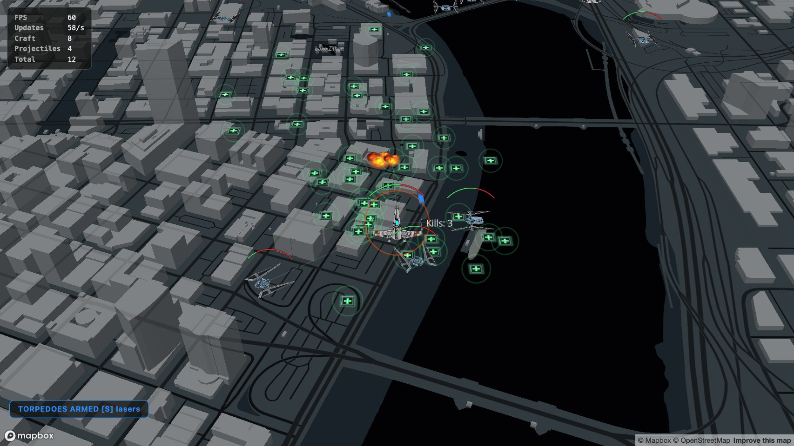
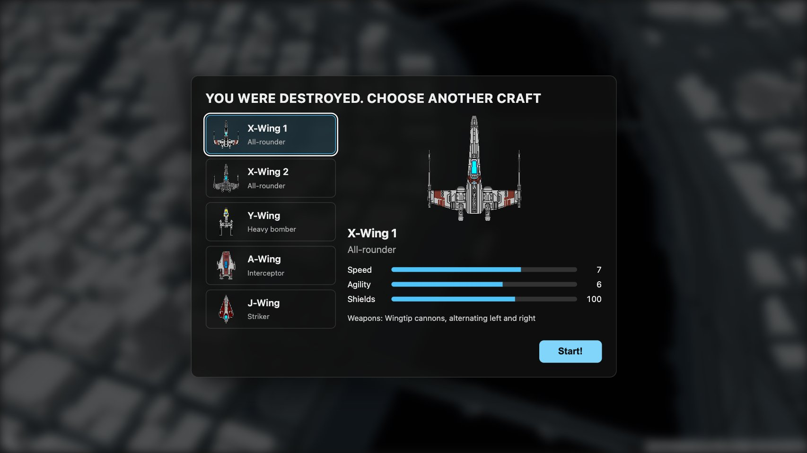

# The Flock
A multi player/user app/game that connects through a (socket.io) websocket server [the-flock-network](https://github.com/yapalexei/the-flock-network) showing fake flyers on a map.

Fighter craft credits go to [kavinveldar](https://www.deviantart.com/kavinveldar/gallery).

## Prerequisites
- node >= 20 and [pnpm](https://pnpm.io) (`corepack enable`)
- [the-flock-network](https://github.com/yapalexei/the-flock-network) running (default `http://localhost:3001`).
- A Mapbox public token: set `MAPBOX_ACCESS_TOKEN` in a `.env` file (overrides `.env.defaults`). Restrict the token to your hosting URLs in the Mapbox dashboard.
- (optional) Docker

## Setup and run steps
- `pnpm install`
- `pnpm start` (dev server on :9000)
- OR (optionally) `MAPBOX_ACCESS_TOKEN=pk... pnpm docker` (static build served by nginx)

## Config (env, baked in at build time)
- `SOCKET_URL` - full URL of the network server, e.g. `https://flock-network.up.railway.app` (must be `https://` when the client is served over https).
- Playing from another device on your network: run both servers on `0.0.0.0` (`CLIENT_HOST=0.0.0.0`, the network server's `HOST` default) and open `http://<this computer's LAN IP>:9000` (find it with `ipconfig getifaddr en0`, or `ifconfig`). Type all four numbers: `192.168.118` is read as `192.168.0.118`. If `SOCKET_URL` points at `localhost` or `0.0.0.0` the page uses the host it was loaded from, so it needs no change. The network server's `ALLOWED_ORIGINS` must allow the page's origin (`*` or `http://<lan ip>:9000`).
- `MAPBOX_ACCESS_TOKEN`, `MAPBOX_STYLE`.

## Hosting on Railway
- Deploy this repo and the-flock-network as two services (each has a Dockerfile).
- Client service variables: `SOCKET_URL`, `MAPBOX_ACCESS_TOKEN`, (`MAPBOX_STYLE`).
- Network service variables: `ALLOWED_ORIGINS=https://<client-domain>`, `ALLOW_RESET=0`, `ROBOTS`, `FPS`; healthcheck path `/health`.

## Game Controls
- The arrow keys.
- space bar to fire
- "t" for 2x speed.
- "s" toggles torpedoes (HUD bottom-left shows the selected weapon).
- Movement is by real elapsed time (`PHYSICS_TICK_MS` in `src/layer/addFlockLayer/index.js` is the tick craft speed and handling are tuned in), so it feels the same at any frame rate. The camera follows your craft every frame, and your own craft is drawn at its local position rather than the last server echo, which keeps it from jittering against the camera.

## Choosing a craft
Once the map has loaded a (blurred-background) dialog lists the craft. Selecting one shows its speed, agility and shields; "Start!" connects and launches the game.
- Speed: top speed. Agility: how quickly the craft changes direction and stops.
- Shields: hit points. The server owns this value per craft (`CRAFT_HIT_CAPACITY` in the-flock-network), so keep it in sync with `src/layer/addFlockLayer/crafts.js` when adding or retuning a craft.
- Cannons alternate: X-Wing, A-Wing and J-Wing fire from the left/right wing cannons, the Y-Wing from its two nose cannons.
- Side cannons are toed in slightly so their shots cross in front of the craft. Without that, X-Wing wingtip shots run ~40m either side of the centreline and can never hit a target dead ahead (the server hit radius is ~17m).
- Enemy fighters (server, `ENABLE_ENEMY_SHOOTING`) fire from side cannons too, alternating, using the same toe-in. Their positions are in `ROBOT_CANNONS` in the-flock-network and assume the default zoom (16).
- When your craft is destroyed the dialog comes back so you can pick another one (the connection and the world carry on).
- Destroyed enemies drop a green recharge box 5% of the time (server `DROP_CHANCE`). Fly over it to restore half your shield capacity.

## Torpedoes, blasts and enemy flight
- Armed torpedoes (`s`) fire at half the laser rate and hit for 10 (lasers 1). A torpedo detonates near any craft and its blast hurts everything within 100m: full damage inside 40m, fading to zero at the edge. You are never hurt by your own torpedo. The server decides the damage; the client only says "torpedo".
- Lasers and torpedoes fly at their base speed plus your craft's speed at the moment you fire, so they stay faster than you at turbo (`t`).
- Every destroyed craft (player or enemy) explodes too: 5 damage within 20m, fading to zero at 50m. That can destroy neighbours in turn (a chain reaction), and the kills are credited to whoever started it.
- Enemies make strafing runs: they fly straight at you, pivot to face away when 40m from you, fly straight away for 0.8-1.6s, pivot back and come again. They only shoot while flying at you. The logic is in the-flock-network `src/server/flight.js`, split into `planFlight` (what the enemy wants) and `applyFlight` (turn and move) so steering rules can adjust heading and speed in between.
- Enemies avoid each other (`src/server/avoidance.js`) using two distances between craft centres: inside the outer one (70m, safe) a fighter steers away from the neighbour, slows down for one ahead and speeds up when pressed from behind; crossing the inner one (35m) is a collision: both take 1 damage (at most every 0.4s each) and are shoved apart. Nobody is credited with a collision kill, but the wreck explodes like any other.
- Health display: players and enemies get an arc over the craft (green = health left on top of red = capacity, 40 steps; span set by `HEALTH_ARC_SPAN_DEG` in `utils.js`). Players also keep the shrinking shield ring, enemies no longer have one, and recharge boxes have a small fixed green ring. All Mapbox filters in `utils.js` must use expression syntax (`['geometry-type']`, not `'$type'`) once they contain `!`/`has`, or Mapbox reads the whole filter as legacy and it matches nothing.
- Shots are drawn as streaks that fade at both tips (Mapbox `line-gradient`, in `utils.js`): red lasers, blue torpedoes, green enemy fire. `line-gradient` can't vary by feature property, so each kind has its own layer; to add a kind of shot, add another `addStreakLayer` call.

## Performance box
Top-left while playing (`src/layer/addFlockLayer/perf-hud.js`, refreshed twice a second): browser FPS, how many world updates per second arrive (the server only sends what changed, so a calm scene shows few or none; it is no longer the server's frame rate), and how many craft and projectiles are inside the viewport (plus their total). The server only sends objects within about 1km of you, so these are lower than what the server is simulating. Mapbox GL JS v1 has no built-in FPS readout (only debug overlays like `map.showTileBoundaries`), so FPS is measured from `requestAnimationFrame`.

## Radar
Top-right while playing (`src/layer/addFlockLayer/radar.js`): you are the blue dot in the middle, north is up, and every enemy the server has sent you is a red dot. The rings are half and full range (1.2 km, `RADAR_RANGE_M` in `index.js`). An enemy past the range is pinned to the rim, dimmer, so you still know which way it is. The server only sends enemies within about 1km of you (`HIDE_OBJS_PAST_RADIUS`), so the radar can only show those. Enemies start spread over a ring 1km to 2.4km around the start position (`ENEMY_RING_INNER_M` / `ENEMY_RING_OUTER_M` on the server), so at the start you see at most a few at the north and south edges and the rest appear as you fly out.

## Sound
- Player shots: `reb-laser.mp3`. Torpedo launch: `missile-fire.mp3`. Enemy shots: `tie-fire-1.mp3`. Any craft destroyed or torpedo detonated: `explosion-large-2.mp3`. Engine hum while any arrow key is held: `engine-wash-2-loop.mp3` (looped, 0.5s fade in, 0.7s fade out).
- Enemy sounds are detected from the server broadcast and kept in check for crowds (`src/layer/addFlockLayer/sounds.js`): a voice cap per sound, enemy shots cut to 0.6s, a little random pitch per playback, distance falloff (silent beyond 500m, nearest first), and a compressor on the output. Your own sounds are never dropped.

## Architecture

The browser sends player state and shots; the server keeps every craft in one world store, simulates only the enemies near a player, and sends each player back only what changed. Details: [Torpedoes, blasts and enemy flight](#torpedoes-blasts-and-enemy-flight) here, and the network server README. The diagram source is `docs/diagrams/flock-architecture.html` (made with the diagram-design skill, "The Flock" dark profile); re-export it to PNG after editing.

## Screenshots

### Choose your craft
Each craft shows its speed, agility and shields before you start; the map behind is blurred until the round begins.

### Flying and fighting
Health arcs over every craft (green on red), the performance box top-left, shot streaks, and recharge boxes (green rings) dropped by destroyed enemies.

### Torpedoes
`s` arms torpedoes: blue streaks, a blast that hurts everything near it, and the weapon indicator bottom-left.

### Destroyed? Pick again

